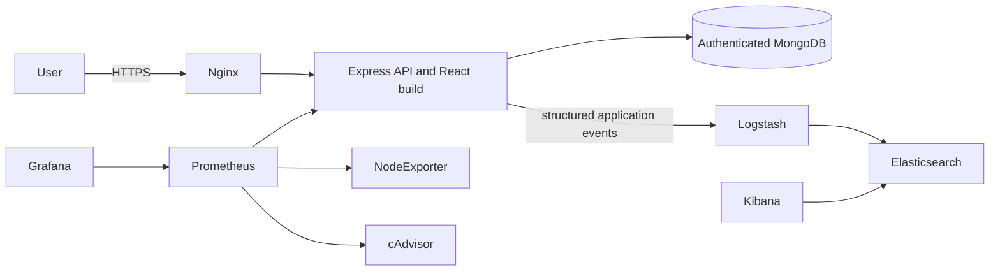

# SmartBus backend and DevOps platform

This repository continues the existing SmartBus application: an Express API serving its existing React build, MongoDB persistence, Swagger, Docker Compose, Nginx, Prometheus, Grafana, and the ELK log platform. It does not replace the application with a sample. Raspberry Pi/OpenCV source and a separate React source repository were not present in the inspected project.

## Platform layout



## Run and validate

Requirements: Docker Engine with Compose, Node.js 22+, and an `.env` file with MongoDB root credentials, `JWT_SECRET`, Grafana admin credentials, and a VM host name. The live VM uses separate authenticated MongoDB variables; its `.env` and data volume are not tracked by Git.

```sh
npm ci
npm test
npm run lint
npm audit --audit-level=moderate
node --check server.js
node --check app.js
```

`docker compose config --quiet` validates the Compose model. Local Compose requires TLS server files and a Kibana Basic-auth file under the ignored `tls/` directory before Nginx can start. The VM certificate is issued by a private local CA because the VM is addressed by a private LAN IP. Keep private keys and `.env` out of Git.

## Service access

Replace `VM_HOST` with the VM's current LAN IP address. Import `docs/tls/SmartBus-Local-CA.crt` into the workstation's trusted root certificate store to remove the browser warning. The certificate includes the inspected VM address; regenerate it if that address changes.

| Service | URL | Access |
|---|---|---|
| SmartBus web app | `https://VM_HOST/` | HTTPS through Nginx |
| API readiness | `https://VM_HOST/health` | JSON readiness plus MongoDB status |
| Swagger | `https://VM_HOST/api-docs/` | API reference |
| Prometheus metrics endpoint | `https://VM_HOST/metrics` | Internal-only backend metric exposition; Prometheus scrapes the service directly |
| Grafana | `https://VM_HOST/grafana/` | Login required; provisioned SmartBus dashboard |
| Prometheus | `https://VM_HOST/prometheus/` | Targets, queries, and alert rules |
| Kibana | `https://VM_HOST/kibana/` | Basic authentication; application log search |

HTTP on port 80 redirects to HTTPS. Nginx is the only application-facing listener. Grafana and Prometheus host ports bind to loopback, and MongoDB, cAdvisor, node-exporter, and Elasticsearch are only reachable inside Docker networks. UFW permits SSH from the VM's LAN subnet and HTTP/HTTPS on ports 80/443.

## Monitoring and logs

Prometheus scrapes the API, node-exporter, cAdvisor, and itself every 15 seconds. Host dashboards cover CPU, memory, root disk, and network traffic. SmartBus panels cover connected buses, student detections, alerts, HTTP latency, and service availability. Bus and detection values reflect real received events and remain zero when no such events have occurred.

Prometheus alert rules cover backend availability, CPU, memory, root disk, node-exporter, and cAdvisor. Grafana provisioning is mounted from `monitoring/grafana/`. Safe structured application lifecycle events are written to the shared log directory and parsed by Logstash into Elasticsearch; Kibana is served through the TLS reverse proxy. Log retention and resource limits are set for the single VM.

## CI/CD and rollback

`.github/workflows/ci.yml` runs on pushes and pull requests to `devops`. The GitHub-hosted validation job installs dependencies, runs tests, ESLint, a full dependency audit, and a Docker build. Only a push or manual run on `devops` reaches the self-hosted deployment job. It builds a commit-tagged backend image, replaces only the `web` Compose service, verifies readiness plus the app and Swagger over HTTPS, and restores the previous image if checks fail. It does not restart MongoDB or monitoring services.

The workflow is published and has completed successfully on the VM runner. A rollback path is configured; it has not been intentionally forced against the live system.

## Security and operations

- `.env`, TLS keys, backups, data, and logs are excluded from source control and Docker build context.
- The Super Admin JWT secret comes from the VM `.env`; changing it invalidates existing login tokens.
- Vehicle records and stop mutations require JWT authentication and administrative roles.
- Nginx applies TLS 1.2/1.3, HSTS, security headers, and login rate limiting.
- The VM has 3.3 GiB RAM. Elasticsearch, Logstash, and Kibana use explicit memory limits and a seven-day index retention policy; host Docker logs are rotated at 10 MB x 3 per container.
- MongoDB is authenticated, has no host-published port, and uses its existing persistent volume. Never run `docker compose down -v` on the VM.
- Kubernetes/K3s is listed as an optional technology in the supplied requirements; this single-host Compose installation remains the deployed architecture.

See [the technical operations guide](docs/technical-guide.md) and [the user guide](docs/user-guide.md).
