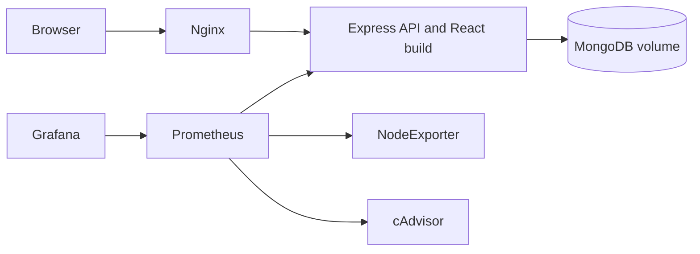

# SmartBus backend and DevOps deployment

The existing SmartBus application is an Express API with a React build served by the same Node process, MongoDB persistence, Swagger documentation, Docker Compose, Nginx, Prometheus, and Grafana. This repository contains the backend and its DevOps configuration; no Raspberry Pi code or separate React source repository is included.

## Architecture



## Requirements

- Ubuntu or another Docker-supported Linux host
- Docker Engine and the Docker Compose plugin
- Node.js 22 and npm for local tests (the metrics client requires Node.js 22 or newer)
- An authenticated MongoDB URI for the deployed database

## Configuration and startup

1. Copy `.env.example` to `.env`. Its MongoDB URI is for local development only; set `MONGO_URI` to the authenticated URI for the existing MongoDB user before deploying. Replace `JWT_SECRET` with a random value generated by `openssl rand -base64 48`. Keep `.env` private; do not commit it.
2. Start the existing Compose stack with `docker compose up -d --build`.
3. Check containers with `docker compose ps` and logs with `docker compose logs --tail=100 web`.

| Variable | Required | Purpose |
|---|---|---|
| `MONGO_URI` | Yes | MongoDB connection string; use the authenticated URI outside local development. |
| `JWT_SECRET` | Yes | Signing and verification key for authentication tokens. |
| `PORT` | No | Express listener port; defaults to 80. |
| `SWAGGER_SERVER_URL` | No | OpenAPI server URL; defaults to the current origin (`/`). |

Compose preserves MongoDB files in the named `mongo_data` volume. Do not remove that volume during upgrades. The local Compose example publishes MongoDB on host port 27017 without configuring database users. The live VM has a separately maintained Compose file using MongoDB 8.2 with authentication and no published MongoDB port; preserve that VM configuration and its `.env` when syncing this repository.

## API and monitoring URLs

Replace `VM_HOST` with the VM's current LAN address:

| Service | URL | Purpose |
|---|---|---|
| App | `http://VM_HOST/` | Existing React build served by Express |
| Readiness | `http://VM_HOST/health` | HTTP 200 only when the Mongoose connection is ready |
| Swagger | `http://VM_HOST/api-docs/` | API reference |
| Prometheus metrics | `http://VM_HOST/metrics` | Runtime, request, and SmartBus metric series |
| Grafana | `http://VM_HOST:3000/` or Nginx `/grafana/` | Provisioned SmartBus Overview dashboard |
| Prometheus | `http://VM_HOST:9090/` | Scrape targets and alert rules |

Current Compose exposes Nginx on host port 8081 and the app on port 80. Local HTTPS certificates are not provisioned in this repository yet; do not describe the deployment as HTTPS enabled until a certificate and TLS listener have been installed and checked on the VM.

Prometheus scrapes the backend, node-exporter, cAdvisor, and Prometheus every 15 seconds. The backend and three infrastructure targets were observed `UP` on the VM after a configuration reload. Three alert rules are loaded for backend availability, high host CPU, and low root disk space; all were inactive during validation. The Grafana dashboard configuration is prepared in this repository, but Grafana provisioning is not mounted by the live VM Compose file and dashboard access still requires Grafana credentials. Bus and student metric series remain at zero until the application receives real events and updates those metrics.

## Local validation

```sh
npm ci
npm test
node --check server.js
node --check app.js
docker compose config --quiet
```

The tests cover healthy and disconnected readiness responses, required Prometheus metric names, Super Admin sign-in and invalid-password behavior, configured MongoDB startup ordering, initialization failures, and idempotent Super Admin initialization. Startup requires `MONGO_URI` and `JWT_SECRET`, then waits for the default Super Admin initialization to complete on that same Mongoose connection. Replacing the old hard-coded JWT key invalidates existing tokens, so users need to sign in again after the secret is changed.

## CI/CD and rollback

The updated GitHub Actions workflow in this working tree runs syntax checks and automated tests on a GitHub-hosted runner. Pull requests never execute on the VM runner and cannot deploy. A push to `devops` or a manual run on `devops` then uses the self-hosted runner to build `smartbusbackend:<commit-sha>` and replace only the Compose `web` service with `--no-deps --no-build`. These workflow changes are not yet published to GitHub, so the existing remote Actions run still represents the previous pipeline.

Before deployment, the workflow records the image configured on the current `web-1` container. It checks `/health`, `/`, and `/api-docs/` for up to 90 seconds. If the new version fails, it restores the previous image and checks the same endpoints again. The workflow fails even after a successful rollback, so the failed release remains visible in Actions. MongoDB and monitoring services are not included in the deployment command.

The workflow requires the self-hosted runner to have Docker access and the Compose project plus `.env` at `/home/shouaib/smartBusBackend`. The VM runner process is online, the project path exists, and the Compose image override is supported. The deployment script has not yet been exercised by a new GitHub Actions run.

## Security and operational limits

- Never add `.env`, keys, tokens, or database backups to Git.
- MongoDB host port exposure and its live authentication state must be reviewed on the VM before deployment changes. This source project does not safely migrate an existing MongoDB volume to authenticated mode.
- Nginx currently proxies HTTP; local TLS remains a deployment task.
- No Alertmanager notification receiver, ELK stack, K3s cluster, load test, or bus simulator is included in the current deployment.
- Review the existing dependency audit findings before broad dependency upgrades; this application contains legacy packages that need compatibility review.

## Report evidence checklist

Capture screenshots from the live VM after each item is verified. Include the date and the commit SHA in figure captions, and redact addresses or account details when needed.

1. GitHub Actions successful test/build/deploy run and its SHA-tagged image (pending publication of this workflow).
2. VM terminal showing `docker compose ps` before and after a backend-only deployment.
3. Browser screenshots in `docs/captures/` showing the existing app, Swagger, readiness JSON, and Nginx proxy readiness.
4. Prometheus Targets screenshot with backend, node-exporter, cAdvisor, and Prometheus `UP`.
5. Grafana SmartBus Overview dashboard with real host metrics (pending Grafana access and provisioning on the VM).
6. Prometheus alert rules screenshot; a forced test alert was not generated against the live backend.
7. Rollback log from the GitHub Actions workflow (pending its first published run); do not simulate failure against the only live service without a verified recovery path.

Screenshots from this local checkout cannot prove the state of the VM. Add them only after capturing and verifying the live pages.
