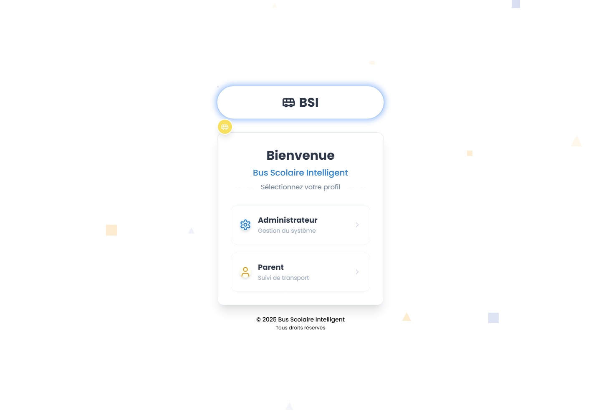
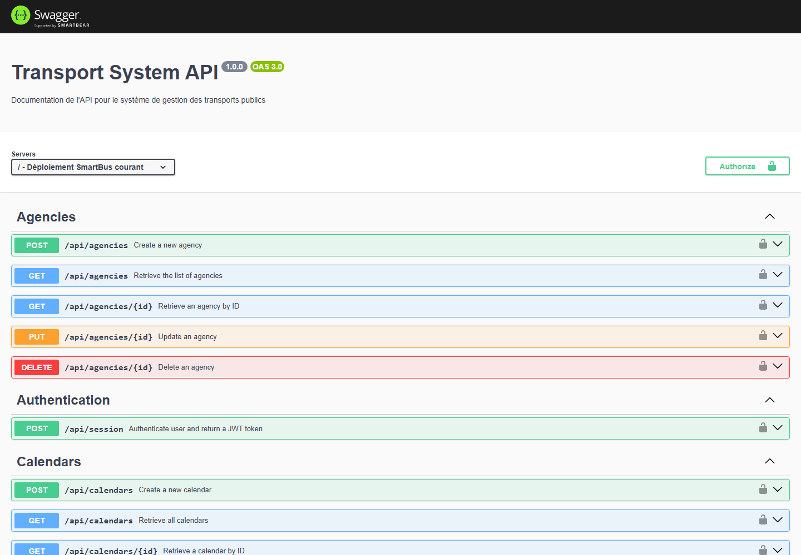
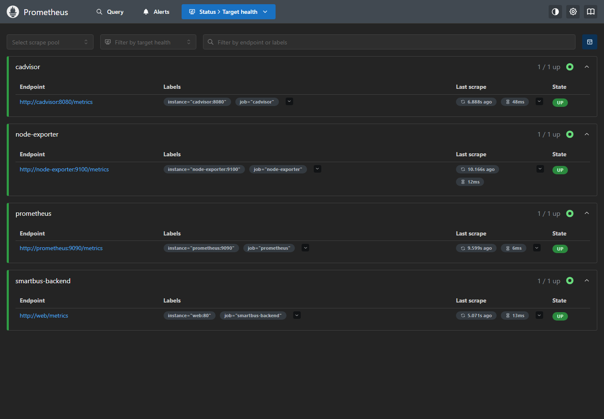
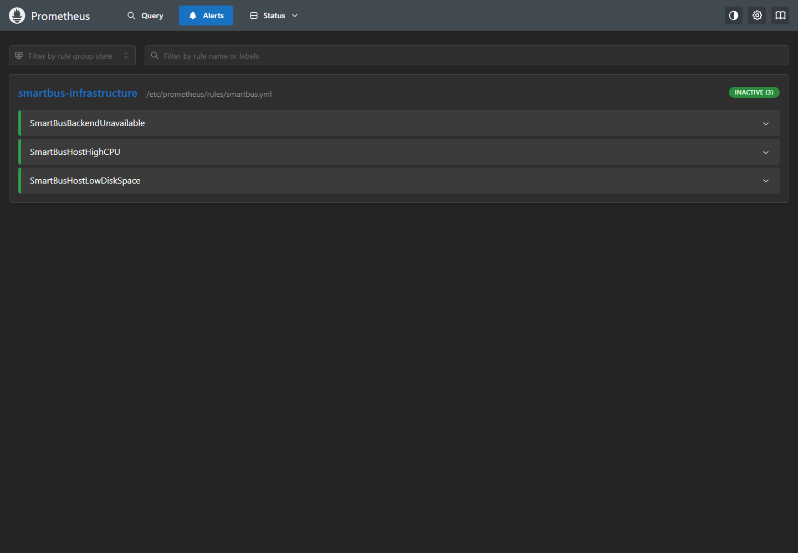
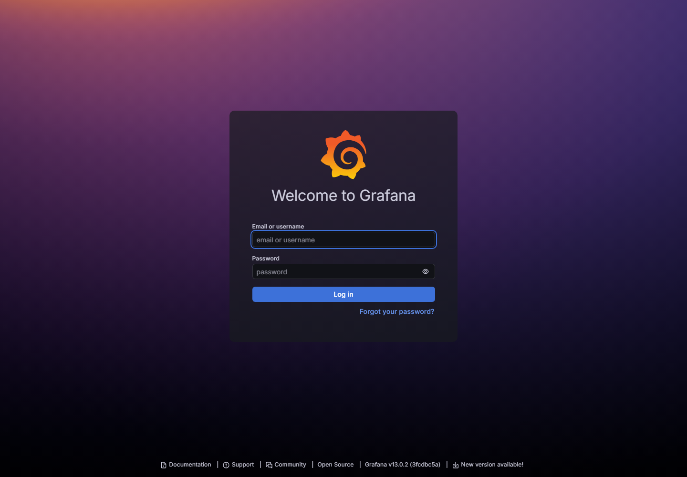
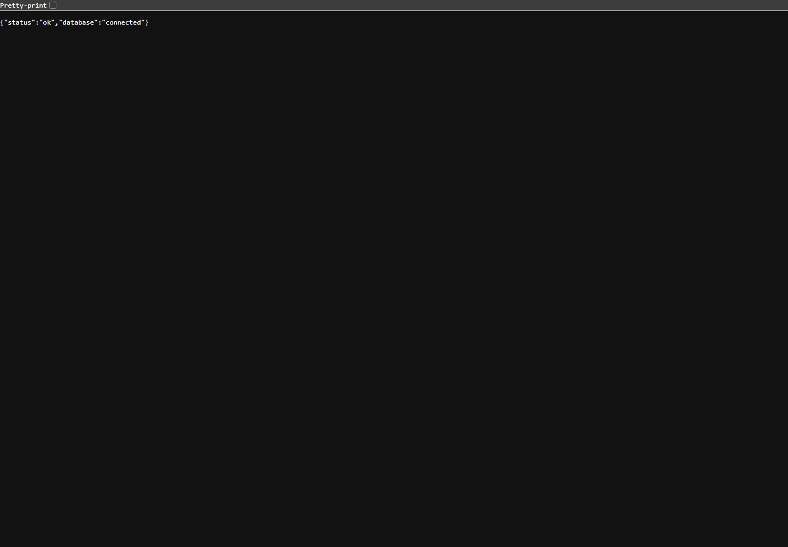

# Dossier de réalisation DevOps — SmartBus

**Date des vérifications :** 19 octobre 2026
**Périmètre :** sections 4 à 8 du *Cahier des Charges* (conteneurisation/CI-CD, reverse proxy et sécurité, supervision, livrables et exploitation). Le cahier des charges rend Kubernetes optionnel; le contexte d'origine du dépôt n'est pas un cluster Kubernetes.

## Environnement et état initial

Le dépôt existant a été repris depuis la branche `devops`; le déploiement est une application Express qui sert aussi le build React existant, avec MongoDB, Nginx, Prometheus, Grafana, cAdvisor et node-exporter. Le code du front React n'est pas séparé dans ce dépôt. La VM Ubuntu est joignable en SSH sous `/home/shouaib/smartBusBackend`.

Avant l'intervention, la page SmartBus et Swagger répondaient. `/health` répondait par l'HTML du front, ce qui ne vérifiait pas l'état du backend. Le login Super Admin échouait avec `Command find requires authentication`; la base contenait déjà un compte Super Admin. Nginx renvoyait 502 parce que son amont résolvait vers l'ancienne adresse IP du conteneur `web`. Prometheus scrappait trois cibles système et n'avait ni cible backend ni règle d'alerte.

## Réalisation et validation

| Élément | Réalisation | Validation |
|---|---|---|
| Image backend | Image `smartbusbackend:codex-20261019-node22`, Node.js 22, utilisateur non privilégié et healthcheck JSON | Construction Docker réussie sur la VM; build context réduit à 9,5 MB et exclut `.env`, Git, tests et données non utilisées par l'application. |
| Readiness | `/health` renvoie un statut JSON qui exige la connexion MongoDB | HTTP 200, `status=ok`, `database=connected`; le conteneur est `healthy`. |
| Super Admin | Connexion MongoDB terminée avant la recherche/création idempotente du Super Admin; initialisation attendue avant l'ouverture du port | Login Super Admin HTTP 200; une route protégée a répondu HTTP 200 avec le JWT émis. Le compte existant et la base n'ont pas été remplacés. |
| JWT | Remplacement de la clé codée en dur par `JWT_SECRET`; une clé a été générée localement sur la VM puis passée au seul service `web` | Le secret n'a pas été affiché. Les sessions JWT existantes doivent se reconnecter après cette rotation. |
| Déploiement | Remplacement du seul service Compose `web` avec `--no-deps --no-build` | Image précédente conservée et image candidate présente. MongoDB et les services de monitoring n'ont pas été redémarrés. |
| Nginx | Résolution dynamique du nom de service Docker `web`; entêtes de sécurité et limitation du débit d'authentification dans la configuration préparée | `nginx -t` réussi, rechargement gracieux effectué; application, `/health` et Swagger répondent HTTP 200 via le port 8081. |
| Prometheus | Cible `smartbus-backend` ajoutée; règles d'indisponibilité backend, CPU hôte et espace disque ajoutées et montées de façon persistante par Compose | `promtool check config` et `promtool check rules` réussis; rechargement SIGHUP sans redémarrage. Les quatre cibles sont `UP`; les trois alertes sont `INACTIVE` pendant la vérification. |
| Tests | Tests unitaires de readiness, métriques, secret JWT, login, ordre de démarrage et initialisation Super Admin | `npm test` : 11 tests réussis, 0 échec; vérifications de syntaxe Node réussies. |
| Sauvegardes | Copie protégée des fichiers VM modifiés et du `.env` avant intervention | `/home/shouaib/smartbus-backups/codex-20261019-174000`; les anciennes copies `docker-compose.yml.backup` et `docker-compose.yml.pre-cd-*` restent intactes. |

### Captures de l'environnement après intervention

**Figure 1 — Application SmartBus existante.**

**Figure 2 — Readiness HTTP JSON, base MongoDB connectée.**

**Figure 3 — Documentation Swagger de l'API.**

**Figure 4 — Cibles Prometheus, incluant le backend et les trois composants d'infrastructure.**

**Figure 5 — Règles d'alerte Prometheus chargées et inactives sur l'état sain.**

**Figure 6 — Écran Grafana. L'authentification n'a pas été tentée et aucun tableau de bord live n'a été validé.**

**Figure 7 — Endpoint readiness accessible à travers le reverse proxy Nginx.**

## CI/CD et limites restantes

Le workflow local sépare la validation sur runner GitHub-hosted du déploiement sur runner self-hosted. Il exécute les tests, la vérification syntaxique, le build, puis remplace seulement `web`, vérifie le JSON de readiness, l'accueil, Swagger et les mêmes routes via Nginx, et restaure l'image antérieure si les contrôles échouent. Le processus du runner self-hosted VM était actif. Le nouveau workflow est encore dans le clone local : il n'a pas été poussé et aucune nouvelle exécution GitHub Actions ni aucun rollback automatisé n'ont été observés.

Grafana est joignable mais reste protégé par son écran de connexion. La configuration de dashboard est préparée dans le clone local, mais n'est pas provisionnée sur la VM. Aucun test d'alerte artificiel n'a été lancé contre le service live. TLS/certificat et ELK ne sont pas déployés; la VM n'a qu'environ 3,3 GiB de RAM et 11 GiB de disque libre au relevé, ce qui ne permet pas d'ajouter prudemment une stack ELK sans plan de ressources. Le serveur demeure en HTTP. Kubernetes n'est pas requis par le cahier des charges fourni.

Le build npm signale 52 vulnérabilités dans les dépendances existantes (1 faible, 31 modérées, 15 élevées, 5 critiques). Les dépendances legacy doivent être mises à jour avec une validation de compatibilité séparée; aucun `npm audit fix --force` n'a été appliqué.

## Livrables locaux

- Code, tests, Dockerfile, `.dockerignore`, workflow, configuration de monitoring et documentation dans le dépôt local `smartBusBackend`.
- Captures PNG sous `docs/captures/`.
- Le fichier `SMARTBUS_COMPLETE_PROJECT_FOR_CODEX.md` cité dans la demande n'a pas été trouvé dans les emplacements vérifiés. Le périmètre a donc été établi à partir du handoff disponible et du PDF fourni.
